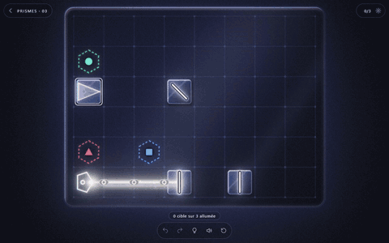
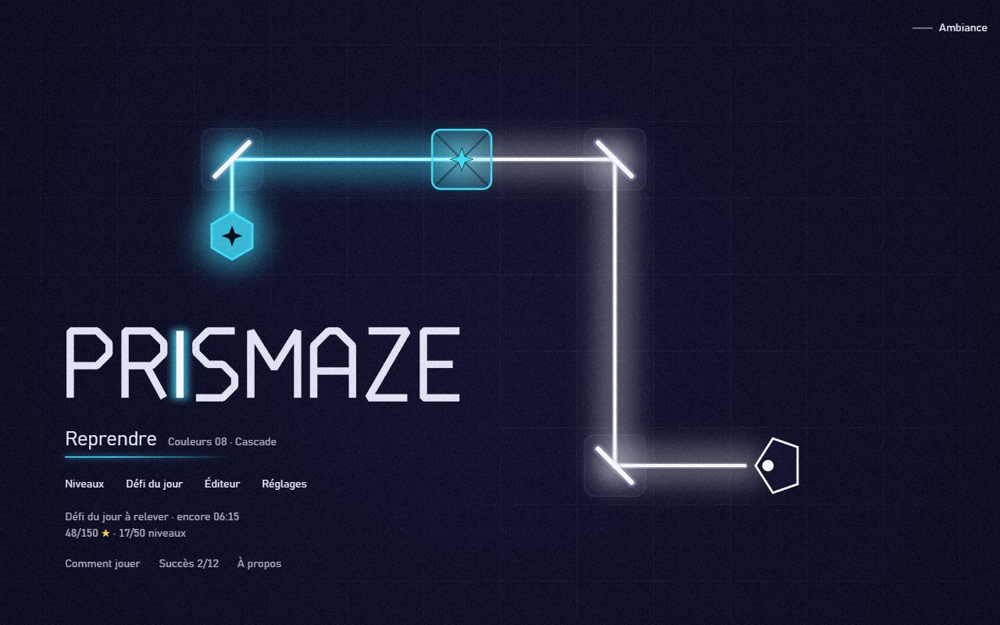
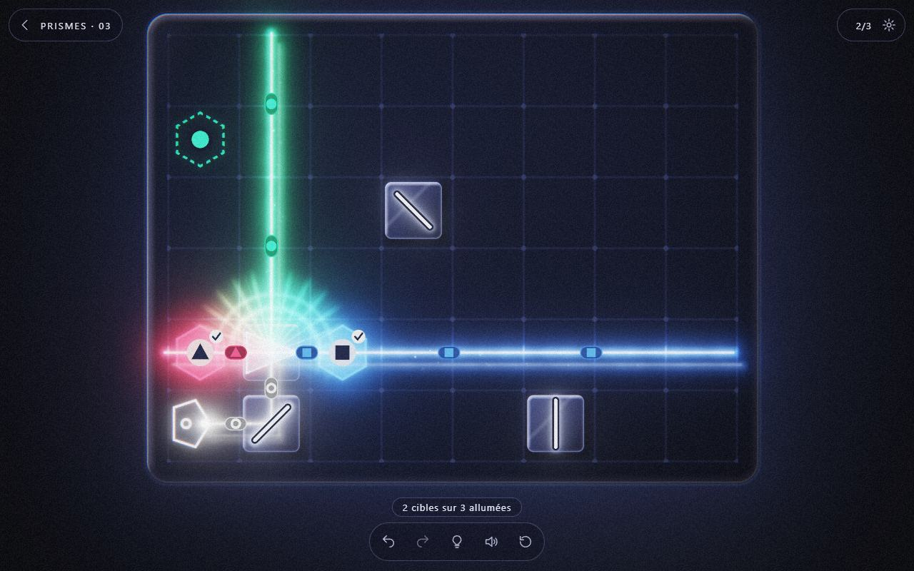
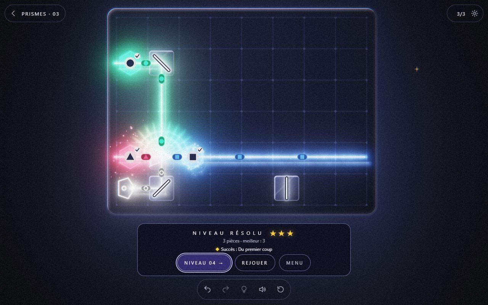

# Prismaze

[Français](README.md) · English

**A laser-maze puzzle game in the browser.** Turn the mirrors, split the light, light up every target in the right colour.

Live demo: [malikchopa.github.io/prismaze](https://malikchopa.github.io/prismaze/)







## The game

The beam follows every gesture, live. There is no explanatory text: each new idea arrives through a small level that shows it. The game runs without a server or an account, and sends no data anywhere.

The code is plain JavaScript (ES modules), with no dependency and no build step.

## The 5 chapters

| Chapter | What it teaches |
|---|---|
| Mirrors | rotating, sliding, going around a wall, watching out for decoys |
| Colours | coloured emitters, mixing light, filters |
| Prisms | splitting white light, then putting it back together |
| Special pieces | splitters, portals, doors that open when a target lights up |
| Mastery | everything at once, with very little slack |

## Features

- **50 levels** in 5 chapters, up to 3 stars per level depending on how many pieces you use.
- **Full-screen WebGL2 rendering**, with an automatic Canvas 2D fallback when the browser lacks it.
- **A living camera, a floating interface** that fades during play, light and victory effects.
- **A hint** that shows the next piece to place.
- **A level editor**, with solver verification right in the browser.
- **Share links**: the level is written in the address, nothing is stored elsewhere.
- **Daily challenge**: a level derived from the date, the same for everyone, with no server.
- **Offline** after the first visit (service worker).
- **Living home screen**: a small laser scene that keeps rearranging itself, chapters and levels, a 3-step « how to play », 12 achievements to unlock, generated ambient music (off by default, `M` key on the home screen).
- **Every screen size**: phone in portrait or landscape, tablet, desktop, ultra-wide, browser zoom.
- **Accessibility**: symbols on top of colours (colour blindness), a reduced motion setting, full keyboard play, announcements for screen readers.

## Controls

| Action | Mouse | Touch | Keyboard |
|---|---|---|---|
| Rotate a piece | click | tap | `R` (`Shift+R`: the other way) |
| Move a piece | drag | drag | arrows to aim, `Space` or `Enter` to pick up then drop |
| Preview the other rotation direction | right click | long press | |
| Undo, redo | buttons | buttons | `Ctrl+Z`, `Ctrl+Y` |
| Hint | button | button | `H` |
| Put back a held piece | | | `Esc` |
| Go back to the previous screen | back button | back button | `Esc` |

## Run it locally

You only need [Node](https://nodejs.org/) 22, for the small local server: the game itself installs nothing.

```sh
git clone https://github.com/MalikChopa/prismaze.git
cd prismaze
node tools/serve.mjs
```

Then open the printed address (`http://127.0.0.1:4180/` if that port is free).

## How it was verified

- **Every level is proved**: the solver establishes that it has a solution and what its minimum piece count is; the proofs live in `levels/proofs/`. Check them with `node tools/verify-levels.mjs`.
- **All 50 minimums were confirmed by a second, independent program** (`node tools/certify-levels.mjs --all`), which shares only the beam engine with the solver: 50 confirmed, 0 refuted.
- **The beam engine is separate from the rendering** and tested on its own, including against a separately written reference.
- **`npm test`**: 785 dependency-free tests, all passing in this copy (measured on 2026-11-11 with Node 22.14).
- The game was also exercised with real inputs in Chrome on Windows (mouse, keyboard, emulated touch and mobile, offline with the server stopped); those runs are not part of this repository.

## What is not tested

Stated plainly, because nobody could check it here:

- **Safari** and **Firefox**: never tried; no Mac was available. Edge was not launched either.
- **Real phones** (iPhone, Android): mobile was only tried under Chrome emulation.
- **Screen readers**: the announcements exist, but no actual screen reader has read them.
- **Photosensitivity**: the flashes in the effects are measured by a home-made analysis, which **is not a certification**. If you are sensitive, turn on reduced motion in the settings.
- **Sound**: synthesised by the game, it has never been listened to by the automated checks.

## License

[GPL-3.0](LICENSE). All images and sounds are generated by the game's code.
