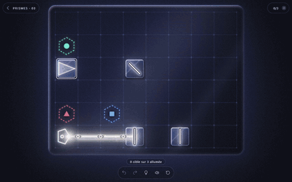
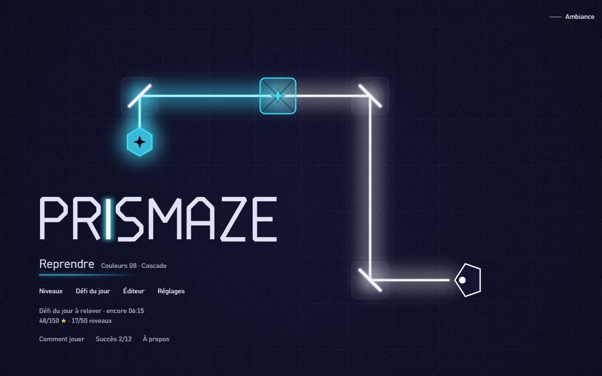
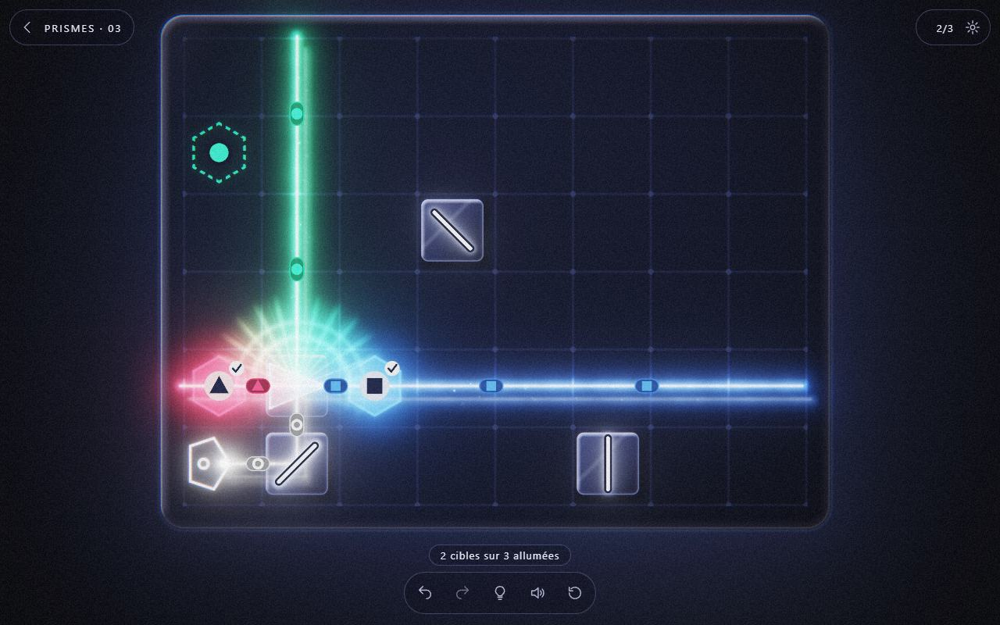
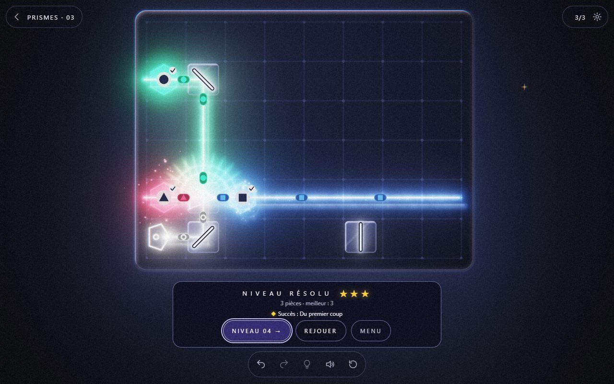

# Prismaze

Français · [English](README.en.md)

**Un jeu de réflexion en labyrinthe de lasers, dans le navigateur.** Oriente les miroirs, sépare la lumière, allume chaque cible de la bonne couleur.

Démo en ligne : [malikchopa.github.io/prismaze](https://malikchopa.github.io/prismaze/)







## Le jeu

Le faisceau suit chaque geste, en direct. Pas de texte d'explication : chaque nouvelle idée arrive par un petit niveau qui la montre. Le jeu tourne sans serveur, sans compte, et n'envoie aucune donnée.

Le code est en JavaScript pur (modules ES), sans aucune dépendance et sans étape de construction.

## Les 5 chapitres

| Chapitre | Ce qu'il enseigne |
|---|---|
| Miroirs | tourner, glisser, contourner un mur, se méfier des leurres |
| Couleurs | émetteurs colorés, mélange des lumières, filtres |
| Prismes | séparer la lumière blanche, puis la recomposer |
| Pièces spéciales | séparateurs, portails, portes qui s'ouvrent quand une cible s'allume |
| Maîtrise | tout à la fois, avec très peu de marge |

## Fonctionnalités

- **50 niveaux** en 5 chapitres, jusqu'à 3 étoiles par niveau selon le nombre de pièces utilisées.
- **Rendu plein écran en WebGL2**, avec repli automatique sur Canvas 2D si le navigateur ne l'a pas.
- **Caméra vivante, interface flottante** qui s'efface pendant le jeu, effets de lumière et de victoire.
- **Indice** qui montre la prochaine pièce à placer.
- **Éditeur de niveaux**, avec vérification par le solveur directement dans le navigateur.
- **Liens de partage** : le niveau est écrit dans l'adresse, rien n'est stocké ailleurs.
- **Défi du jour** : un niveau tiré de la date, le même pour tout le monde, sans serveur.
- **Hors ligne** après la première visite (service worker).
- **Accueil vivant** : une petite scène de lasers qui se recompose sans cesse, chapitres et niveaux, « Comment jouer » en 3 étapes, 12 succès à débloquer, musique d'ambiance générée (coupée par défaut, touche `M` sur l'accueil).
- **Toutes tailles d'écran** : téléphone en portrait ou couché, tablette, ordinateur, très grand écran, zoom du navigateur.
- **Accessibilité** : symboles en plus des couleurs (daltonisme), réglage de mouvement réduit, jeu complet au clavier, annonces pour les lecteurs d'écran.

## Commandes

| Action | Souris | Toucher | Clavier |
|---|---|---|---|
| Tourner une pièce | clic | toucher | `R` (`Maj+R` : l'autre sens) |
| Déplacer une pièce | glisser | glisser | flèches pour viser, `Espace` ou `Entrée` pour prendre puis poser |
| Voir l'autre sens de rotation | clic droit | appui long | |
| Annuler, refaire | boutons | boutons | `Ctrl+Z`, `Ctrl+Y` |
| Indice | bouton | bouton | `H` |
| Reposer une pièce prise | | | `Échap` |
| Revenir à l'écran précédent | bouton retour | bouton retour | `Échap` |

## Lancer en local

Il faut seulement [Node](https://nodejs.org/) 22, pour le petit serveur local : le jeu lui-même n'installe rien.

```sh
git clone https://github.com/MalikChopa/prismaze.git
cd prismaze
node tools/serve.mjs
```

Ouvre ensuite l'adresse affichée (`http://127.0.0.1:4180/` si ce port est libre).

## Comment c'est vérifié

- **Chaque niveau est prouvé** : le solveur établit qu'il a une solution et quel est son nombre minimum de pièces ; les preuves sont dans `levels/proofs/`. Vérification : `node tools/verify-levels.mjs`.
- **Les 50 minimums sont confirmés par un second programme indépendant** (`node tools/certify-levels.mjs --all`), qui ne partage avec le solveur que le moteur de faisceau : 50 confirmés, 0 réfuté.
- **Le moteur de faisceau est séparé du rendu** et testé seul, y compris contre une référence écrite à part.
- **`npm test`** : 785 tests sans dépendance, tous réussis dans cette copie (mesuré le 2026-11-11 avec Node 22.14).
- Le jeu a aussi été essayé avec de vraies entrées dans Chrome sur Windows (souris, clavier, toucher et mobile émulés, hors ligne serveur coupé) ; ces essais ne font pas partie de ce dépôt.

## Ce qui n'est pas testé

Dit franchement, parce que personne n'a pu le vérifier ici :

- **Safari** et **Firefox** : jamais essayés ; aucun Mac disponible. Edge n'a pas été lancé non plus.
- **Téléphones réels** (iPhone, Android) : le mobile n'a été essayé qu'en émulation dans Chrome.
- **Lecteurs d'écran** : les annonces existent, mais aucun vrai lecteur d'écran ne les a lues.
- **Photosensibilité** : les flashs des effets sont mesurés par une analyse maison, qui **n'est pas une certification**. En cas de sensibilité, active le mouvement réduit dans les réglages.
- **Le son** : synthétisé par le jeu, il n'a jamais été écouté par les outils automatiques de vérification.

## Licence

[GPL-3.0](LICENSE). Toutes les images et tous les sons sont générés par le code du jeu.
